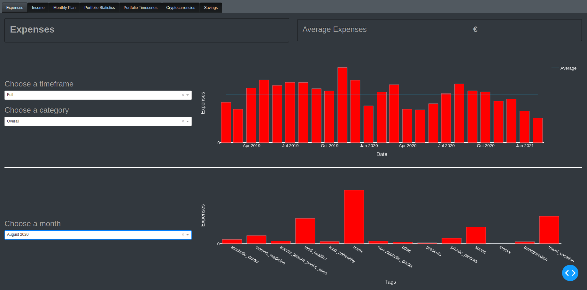
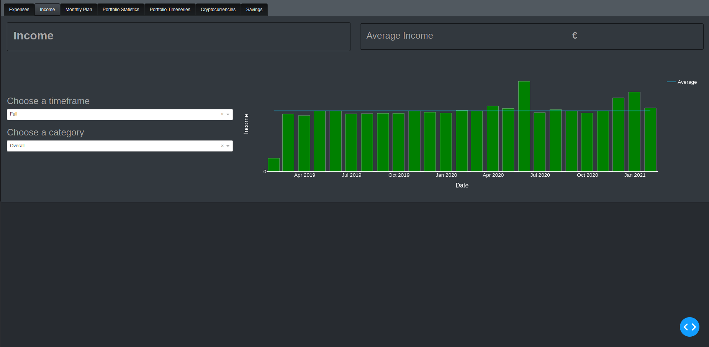
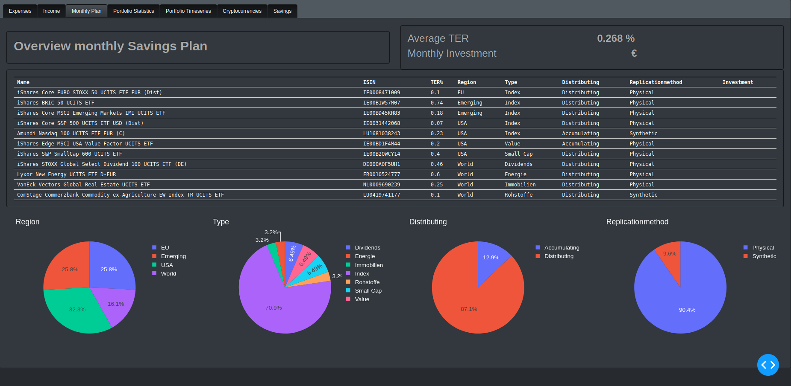
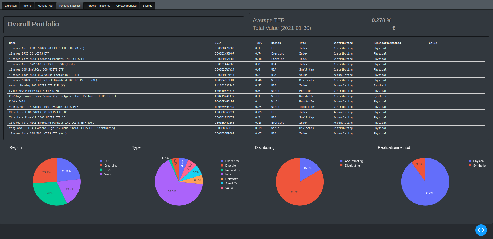
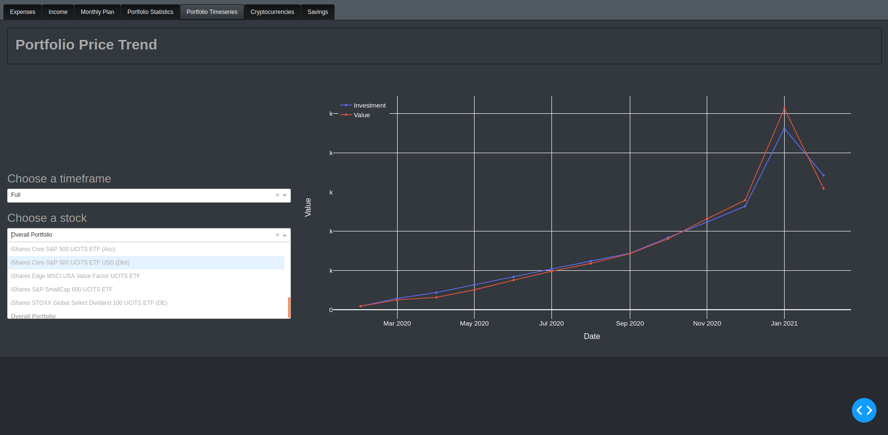
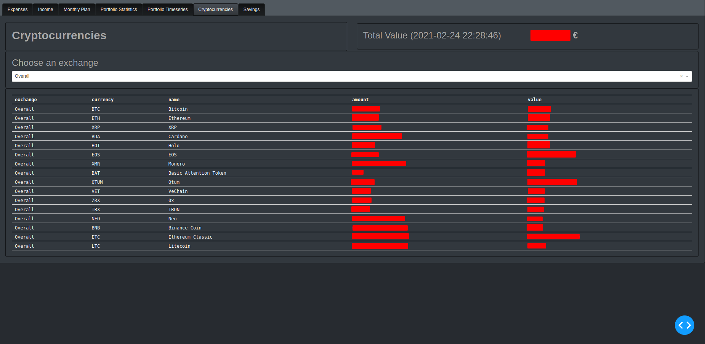

# Personal-Finance Dashboard

An interactive dashboard (Python, [Plotly Dash](https://dash.plotly.com/)) for your personal
finances: incomes and expenses, the investment portfolio and the cash balance sheet.

The dashboard only **displays** data. All data comes from the
[personal-finance-datahub](https://github.com/christophpernul/personal-finance-datahub), which
reads your exports and hand-maintained files and does the calculations.

- [Quick start](#quick-start)
- [Where the data comes from](#where-the-data-comes-from) — what you maintain by hand
- [Tabs](#tabs) — what each tab shows and how its numbers are calculated
- [Legacy: classic dashboard](#legacy-classic-dashboard)

## Quick start

1. Update your data and run the datahub (see its README, *Routine checklist*).
2. Start the dashboard from the repository root:

   ```bash
   python -m src.interactive_dashboard.app
   ```

3. Open http://127.0.0.1:8050.

The data is loaded once at start-up: after a datahub run, restart the dashboard. Environment
variables to override the defaults:

| Variable | Default | Purpose |
| --- | --- | --- |
| `DASH_PORT` | `8050` | Port to serve on |
| `DASH_DEBUG` | `1` | Debug mode (`0`/`false` to disable) |
| `DASH_RELOAD` | `0` | Hot reloader (`1`/`true` to enable) |
| `FINANCE_DATA_DIR` | `D:\SynologyDrive\Finance\data\datahub\target` | Datahub `target` folder |
| `FINANCE_TRANSFORM_DIR` | `D:\SynologyDrive\Finance\data\datahub\transform` | Datahub `transform` folder |

## Where the data comes from

You never edit the dashboard's input files directly: they are written by the datahub. What you
maintain by hand lives in the datahub folder `D:\SynologyDrive\Finance\data\datahub\source\`;
the datahub README lists every file, its columns and when to update it. In short:

| To see … | maintain in the datahub `source/` folder |
| --- | --- |
| Incomes and expenses | monthly Toshl export `cashflow/toshl/bilanz_YYYY_MM.csv`; new tags in `toshl_tag_categorization.json` (datahub repository) |
| ETF and stock positions, dividends, received interest | `stocks/source_stocks_portfolio_trades.ods` (ETFs, `Zinsen`, `Riester Buy`), `stocks/source_stocks_trades.ods` (stocks) |
| Riester contract | its value in `stocks/source_stocks_riester_value.ods`, fees via the Raisin export `stocks/raisin_riester_gebuehren.csv` |
| Crypto | exchange exports in `crypto/`, new coins in `crypto/source_crypto__master_data.csv` |
| Accounts, Festgeld, credit card, loan | `cash/source_cash_balance_sheet.ods` (sheets `Konten`, `Kontostaende`, `Festgeld`) |
| Corrections of exports | `source_manual__transactions.csv` |

Files each tab reads (all written by the datahub):

| Tab | Files |
| --- | --- |
| Expenses, Income, Cashflow, Yearly, Transactions | `target/target_cashflow__expenses.csv`, `target/target_cashflow__incomes.csv` |
| Portfolio | `transform/transform_portfolio__value.csv`, `transform/transform_crypto__portfolio_value.csv`; for returns `transform/transform_portfolio__cashflows.csv`, `transform/transform_crypto__ledger.csv`, `transform/transform_crypto__trades.csv`, `transform/transform_crypto__coins.csv` |
| Sold Positions | `target/target_portfolio__sold_positions.csv`, `target/target_portfolio__sold_position_flows.csv` |
| Balancesheet | `transform/transform_cash__balances_monthly.csv`, `transform/transform_cash__term_deposits.csv`, `transform/transform_cash__liquidity_monthly.csv` (if missing, the tab shows a hint and the rest still works) |

## Tabs

Amounts are in EUR. The navigation has three sections.

### Cashflow

Every income and expense is a single transaction with a category; positive amounts are money in,
negative money out (the charts show both as positive bars).

- **Expenses / Income** — monthly totals as bars for a month range you pick (slider or *Full*,
  *This year*, *Last 12M*, *Last 6M*). The dashed line is the **average** = sum of the monthly
  totals in the range / number of months. Clicking a month shows its spending per category;
  clicking a category lists its transactions. The category chart next to it shows the **average
  per month per category** over the range.
- **Cashflow** — income − expenses per month (green surplus, red deficit) and its average.
- **Yearly** — totals per calendar year and per category. *Year to date* compares every year only
  up to the same month: the running month is incomplete, so year-to-date ends with the **last
  complete month**. Two years can be compared category by category, with the change between them.
- **Transactions** — every income and expense in one table, filterable and sortable; the line
  above it sums whatever the filters leave.

### Investment

- **Portfolio** — every open position: ETFs, stocks, the Riester contract and crypto, one KPI card
  per group plus the total. Per position:
  - *Investment* — money put in (buys − sell proceeds; crypto: cost basis of the coins held),
    *Costs* — order costs and fees,
  - *Value* — shares × current price (Riester: the value you entered),
  - *Gain* = value − investment − costs (Riester: value − investment, because its fees were
    already taken out of the contract), *Gain %* = gain / investment,
  - *Return p.a.* — money-weighted return per year (XIRR): the yearly rate at which all cashflows
    of the position (buys and contributions negative, sales and dividends positive, today's value
    as if sold today) add up to zero. It accounts for when the money went in, unlike Gain %.
    For a group or the total, all flows of its positions together; crypto as a class uses the EUR
    moved between bank and exchanges. Coins bought mostly by swapping other coins have no EUR
    price in the data and get no return.
  - *As of* — the date of the data (ETFs/stocks: month of the last trade, prices are current;
    Riester: date of the value).

  Filters (group, depot/exchange, name, gainers/losers) update the summary line.
- **Sold Positions** — every closed ETF/stock position with what it was bought and sold for,
  dividends, order and ongoing costs, *net profit* = proceeds + dividends − buy amount − costs,
  *ROI* = net profit / buy amount and *return p.a.* (XIRR of its flows). The KPI cards sum the
  positions left by the filters (ROI and return computed over all their flows together); clicking
  a position lists its single cashflows. How positions, costs and dividends are assigned is
  described in the datahub README (*Sold positions*).

### Balance Sheet

- **Balancesheet** — where your cash lies and what you owe:
  - KPI cards: *Net cash* = available + bound − owed; *Available* = sum of the latest balances of
    the cash accounts; *Bound* = sum of the running fixed-term deposits; *Liabilities* = what is
    owed on credit cards and loans; *Next maturity* = the running or upcoming deposit that ends
    first; *Average interest rate* = Σ (amount × rate) / Σ amount over the cash accounts and
    running deposits (accounts without a rate count as 0 %, liabilities are left out).
  - Accounts and liabilities tables with balance, rate, *rate valid until* and the date of the
    balance, marked *outdated* when it is more than 35 days old.
  - Fixed-term deposits: table with progress (elapsed / term) and a timeline with today's date.
  - *Available vs. bound cash* per month. Months after the current one are a faded projection:
    balances stay as they are and each deposit moves to *available* when it matures. Liabilities
    appear below zero once anything is owed.

  No interest amounts are calculated: received interest is part of the income data
  (`Tagesgeld` / `Festgeld`).

## Legacy: classic dashboard

The repository also contains the original dashboard in `src/dashboard`, wired to its own older
data layer in `src/datahub` with different input files (below). It is independent of the
interactive dashboard and the datahub repository, and no longer maintained.

```bash
cd src
python -m dashboard.main_app
```

It also starts on port 8050, so run only one of the two at a time, or set `DASH_PORT` on the
interactive dashboard.

<details>
<summary>Input files and screenshots of the classic dashboard</summary>

- finanzübersicht.ods (libreOffice calc)
    - Sheet: 3.2 Portfolio langfristig Transactions
        Columns:
            "Index": Index for a single savings plans execution (integer, is empty in case of dividend payments)
            "Datum": Date of execution (dd.MM.yyyy)
            "Kurs": Price of stock (xx.xx)
            "Betrag": Amount (€) of investment per execution (xx.xx)
            "Kosten": Costs (ordercost in xx.xx)
            "Anbieter": Brokername
            "Name": Name of stock
            "ISIN": ISIN of stock
            "Art": Type of investment (should be "ETF Sparplan" for savings plan)
            "Kommentar": Should be "monatlich" for savings-plan entry and "Dividende" for a dividend payment
    - Sheet: 3.4 Spekulation Transactions
            not used atm
    - Sheet: 3.3 Income Transactions
            "Datum": Date of income transaction (dd.MM.yyyy)
            "Art": Type of income ("Gehalt")
            "Betrag": amount (xx.xx)
- crypto_trades.ods (libreOffice calc)
  - Sheet "Deposits": First two rows as header (skipped)
        Columns:
            "date": Date of deposit
            "amount": Amount of currency deposited
            "currency": Symbol of cryptocurrency
            "price": Buy price
            "fee %": Fee in Euro
            "exchange": Crypto-Exchange name
            "total price": Total price in Euro
     - Sheet "Trades": First row as header (skipped)
          Columns:
              "date": Date of deposit
              "amount_spent": Amount of currency spent (sold)
              "currency_spent": Symbol of sold cryptocurrency
              "amount_gained": Amount of currency gained (bought)
              "currency_gained": Symbold of bought cryptocurrency
              "fee comment": Comment about fees
              "exchange 1": Crypto-Exchange of Sell action
              "exchange 2": Crypto-Exchange of Buy action
              "fee": transaction-fee in "fee currency"
              "fee currency": Name of currency with which fee was paid
- stock_prices.ods ((libreOffice calc)
        - created with script "update_finance_data.py"
- master_data_stocks.ods (libreOffice calc)
        - created with script "update_finance_data.py"
- bilanz_full.csv
        - Multiple monthly Toshl export files are appended into a single file
            The app assumes, that you use a single category and a single tag for each entry. The tags are later remapped to custom categories, that are more useful.

**Monthly expenses** — average monthly expenses, total expenses over time (filter by timeframe
and category) and expenses per category of a selected month.



**Monthly income** — average monthly income and a bar chart filtered by timeframe and category.



**Monthly ETF savings plan** — the ETFs of the savings plan with TER, region and further
properties, average cost and investment per month, and pie charts of the diversification.



**Overall portfolio value** — the same analysis for the whole portfolio and its latest value.



**Portfolio value over time** — portfolio value and accumulated investment, filterable by
timeframe and ETF.



**Cryptocurrency portfolio** — total crypto value and each coin's amount and value, filterable by
exchange.



</details>
